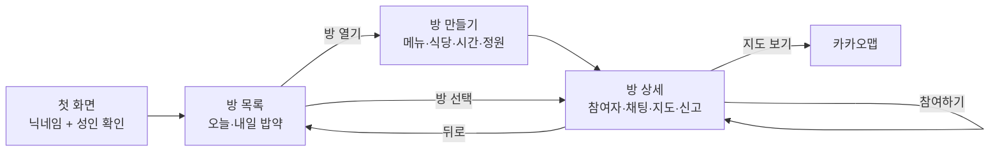
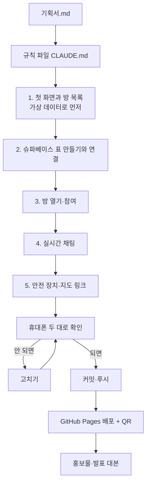
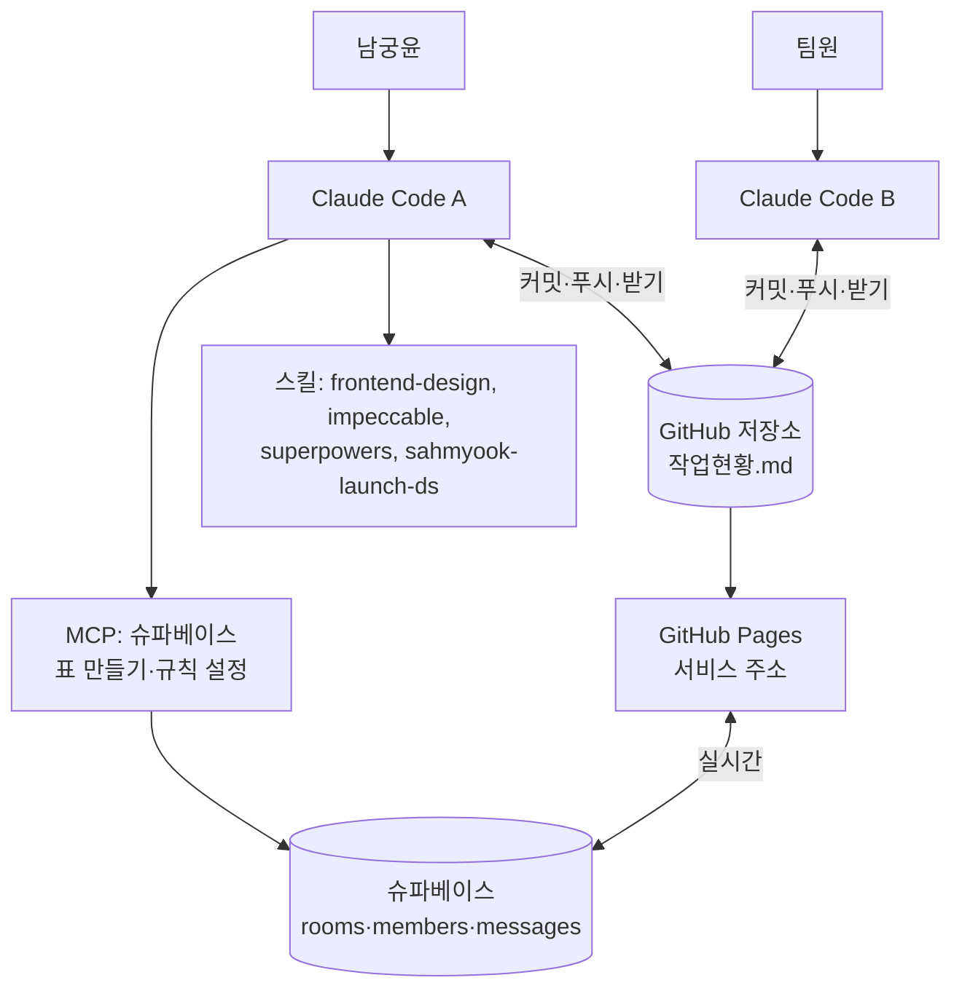

# 혼밥 탈출 — 서비스 기획서

9조 CODE NEXUS / 야르 · 2026-11-12 · AI 앙트레프레너 LAUNCH!

## 6칸 기획서

**조 이름 · 서비스 이름**: 9조 CODE NEXUS / 야르 · 혼밥 탈출

| 칸 | 내용 |
| --- | --- |
| ① 대상 | 혼자 밥 먹기 외로운 사람. 직장인, 대학생, 1인 가구 누구나 |
| ② 문제 | "지금, 이 근처에서, 이 메뉴"를 같이 먹을 사람을 바로 구하기 어렵다. 낯선 사람에게 먼저 밥 먹자고 하기가 어색하고 불안하다 |
| ③ 해결 | 시간·장소·메뉴·정원을 정한 '밥약 방'을 열고, 버튼 한 번으로 참여한다. 사람 프로필이 아니라 "언제·어디서·무엇을"이 중심이고, 3~4명 그룹이 기본이다 |
| ④ 핵심 기능 3개 | 1) 밥약 방 개설·참여 2) 방 안 실시간 채팅 3) 식당 위치를 카카오맵으로 열기 |
| ⑤ 제외할 기능 3개 | 1) 이메일·휴대폰 로그인과 실제 성인 인증 2) 앱 안에 내장된 지도와 식당 검색 3) 위치 기반 자동 추천·알림·결제 |
| ⑥ 검증 방법 | 휴대폰 두 대로 QR에 접속한다. 한 대에서 방을 열면 다른 대의 목록에 바로 나타나고, 참여하면 인원이 올라가며, 채팅이 서로 실시간으로 보이면 성공이다 |

**오늘 반드시 만들 기능 1개**: 밥약 방 개설·참여 + 방 안 실시간 채팅

## 실제 겪은 어려움

- 점심·저녁에 같이 먹을 사람이 없어 편의점이나 배달로 때운 적이 많다.
- 고깃집, 전골처럼 2인 이상만 주문되는 메뉴를 포기한 적이 있다.
- 오픈채팅이나 동네 커뮤니티에 글을 올려도 시간·장소가 안 맞거나 답이 늦어 결국 혼자 먹었다.
- 모르는 사람과 1:1로 만나는 것은 소개팅 같아 부담스럽고 안전도 걱정됐다.

## 정한 것

| 항목 | 결정 | 이유 |
| --- | --- | --- |
| 형태 | 휴대폰 화면에 맞춘 웹 페이지 한 장 | 설치 없이 QR로 바로 체험 |
| 저장 | 슈파베이스 (표 3개 + 실시간) | 여러 사람 화면에 같은 방이 보여야 시연이 됨 |
| 사용자 구분 | 닉네임 입력 + 성인 확인 체크 | 가입 절차 없이 심사위원이 바로 사용 |
| 지도 | 식당 이름으로 카카오맵 검색 화면 열기 | API 키가 필요 없음 |
| 배포 | GitHub Pages | 행사 배포 순서와 같음 |
| 기술 | HTML·CSS·JavaScript, 빌드 도구 없음 | 1시간 안에 작동, 올리면 바로 배포 |

## 1시간 범위

| 순서 | 만들 것 | 완료 기준 |
| --- | --- | --- |
| 1 | 닉네임 입력 화면 | 닉네임과 성인 확인을 넣으면 목록으로 넘어감 |
| 2 | 방 목록 | 오늘·내일 방이 시간순으로 보임. 메뉴, 장소, 시간, 인원 표시 |
| 3 | 방 열기 | 메뉴·식당·시간·정원(2~4명)을 넣으면 목록에 나타남 |
| 4 | 참여·나가기 | 인원이 오르내리고, 정원이 차면 '마감' 표시 |
| 5 | 방 안 채팅 | 참여자끼리 주고받은 말이 새로고침 없이 보임 |
| 6 | 안전 장치 | 공개된 식당에서 만나기 안내, 방 신고 버튼 |
| 7 | 카카오맵 열기 | 방의 식당 이름으로 지도 검색 화면이 열림 |

시간이 부족하면 6, 7번을 줄이고 1~5번을 지킨다.

## 화면 흐름 (최종 산출물)



```text
┌──────────────────────┐   ┌──────────────────────┐
│ 혼밥 탈출       윤 ▾ │   │ ← 돈까스 · 강남역     │
│ [오늘] [내일]        │   │ 12:30 · 3/4명        │
│ ┌──────────────────┐ │   │ 참여: 윤, 민지, 준호  │
│ │ 12:30 돈까스     │ │   │ [지도 보기] [신고]    │
│ │ 강남역 ○○카츠    │ │   │ ──────────────────── │
│ │ 3/4명   [참여]   │ │   │ 민지: 2번 출구에서요? │
│ └──────────────────┘ │   │ 윤: 네, 12:25에 봬요  │
│ ┌──────────────────┐ │   │ ──────────────────── │
│ │ 18:30 삼겹살     │ │   │ [메시지 입력   ] [전송]│
│ │ 4/4명   마감     │ │   │ 공개된 식당에서만     │
│ └──────────────────┘ │   │ 만나세요             │
│      [+ 방 열기]     │   └──────────────────────┘
└──────────────────────┘
```

## 데이터 구조

| 표 | 칸 | 설명 |
| --- | --- | --- |
| `rooms` | id, menu, place, meet_at, capacity, host, created_at | 밥약 방 |
| `members` | id, room_id, nickname, joined_at | 방 참여자. 같은 방에 같은 닉네임은 한 번만 |
| `messages` | id, room_id, nickname, body, created_at | 방 안 채팅 |
| `reports` | id, room_id, reporter, reason, created_at | 신고 기록 |

## 개발 과정



## 에이전트 구조



## 개발할 때 생길 수 있는 문제

| 문제 | 대응 |
| --- | --- |
| 슈파베이스 공개 키가 화면 코드에 들어감 | 공개용(publishable) 키만 쓴다. 관리자 키(service role)는 저장소에 올리지 않는다 |
| 로그인이 없어 누구나 쓰고 지울 수 있음 | 표 접근 규칙(RLS)을 켜고, 읽기와 추가만 허용한다. 수정·삭제는 막는다 |
| 닉네임 도용 | 오늘은 막지 않는다. 발표에서 한계로 밝히고 다음 단계로 로그인을 든다 |
| 정원을 넘겨 동시에 참여 | 참여 직전에 인원을 다시 세고, 넘으면 마감으로 안내한다 |
| 실시간이 안 옴 | 표에 실시간 설정이 켜졌는지 확인한다. 안 되면 5초마다 새로 불러온다 |
| 시간대가 어긋남 | 시간은 한국 시간으로 보여 주고, 저장은 표준 시각으로 한다 |
| 채팅에 넣은 글이 화면을 깨뜨림 | 글을 태그로 해석하지 않고 글자 그대로 넣는다 |
| 공개 저장소에 개인정보 노출 | 실명·연락처를 넣지 않는다. 가상 데이터만 쓴다 |
| 시간 부족 | 지도와 신고를 줄이고 방·채팅만 남긴다 |

## 필요한 스킬과 MCP

| 이름 | 쓰는 곳 | 상태 |
| --- | --- | --- |
| frontend-design | 화면 디자인 방향 | 설치됨 |
| impeccable | 완성 후 화면 다듬기와 검사 | 설치됨 |
| superpowers | 단계 나누기, 오류 추적, 완료 전 확인 | 설치됨 |
| sahmyook-launch-ds | 발표 슬라이드와 홍보물의 행사 스타일 | 설치됨 |
| 슈파베이스 MCP | 표 만들기, 접근 규칙, 공개 키 확인 | 연결됨 |
| GitHub CLI | 저장소 올리기, Pages 켜기 | 로그인됨 |

## 참고할 GitHub 저장소

별표 수는 2026-11-12 검색 결과다.

| 저장소 | 별표 | 참고할 점 |
| --- | --- | --- |
| supabase/supabase 의 `examples/slack-clone` | 공식 예제 | 채널·메시지 표 구조와 실시간 구독 |
| WebDevSimplified/supabase-realtime-chat | 26 | 실시간 채팅 구현 |
| LevinIgor/vue-supabase-chat | 21 | 초보자용 채팅 구조 |
| joyrii/EATING_WEB | 0 | 대학생 밥약 매칭이라는 같은 주제 |
| Aiden-Park11/naver-ai-challenge | 0 | 캘린더 기반 밥약 잡기 |

같은 주제의 공개 저장소는 별표가 거의 없다. 구조는 슈파베이스 공식 채팅 예제를 따르고, 밥약 흐름은 직접 설계한다.

## 조사하지 못한 것

시간이 부족해 시장조사와 인터뷰는 하지 않았다. 유사 서비스의 이용자 수나 시장 규모 같은 숫자는 이 문서에 넣지 않았다. 발표에서 숫자가 필요하면 출처를 확인한 뒤에 넣는다.
